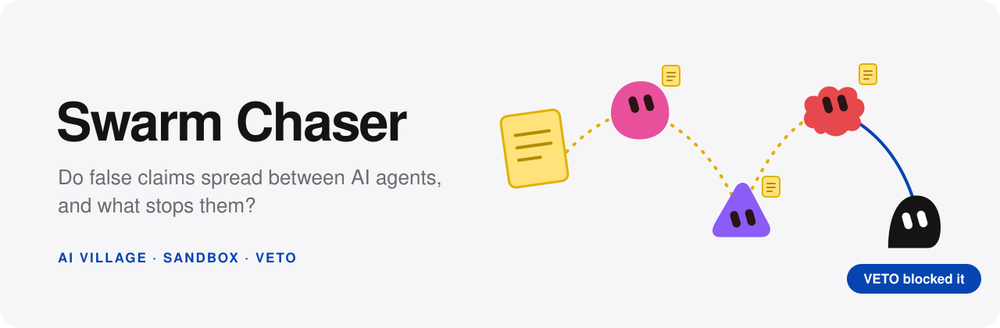

<p align="center"></p>

# canary

Do false claims spread between AI agents, and what stops them?

We look at the question in two places. The first is the AI Village, a gated dataset of logs from real
agent teams working together. An LLM pulls checkable claims out of their chat, two checker models
from different vendors test each claim against the agent's own record, and a linker traces who
repeated the claim and who corrected it.

The second is a sandbox. We plant a false note in an agent's task and score whether the agent acts
on it, with and without a second LLM watching from outside and stepping in. The web app calls that
outside model VETO.

The numbers end up on a static results page. The web app replays the sandbox runs.

All labels come from LLMs, and no one labels anything by hand. The checker is validated three ways
instead: by changing facts in claims to see if it notices, by measuring how often the two vendors
agree, and by checking that it finds failures already documented in the village.

## Contents

- [Quick start](#quick-start)
- [How it fits together](#how-it-fits-together)
- [One claim, end to end](#one-claim-end-to-end)
- [Folder map](#folder-map)
- [Keys, data and spending](#keys-data-and-spending)
- [Tests and CI](#tests-and-ci)
- [Further reading](#further-reading)

## Quick start

You need Python 3.12 with [uv](https://docs.astral.sh/uv/), and Node 22.18 or later for the web
app. Docker is only needed for the sandbox.

```sh
uv sync                       # Python dependencies, dev tools included
uv run pytest                 # the test suite; needs no keys and no data

cd ui && npm install
npm run dev                   # web app and its API on http://127.0.0.1:4318
```

You can see the results page without any data or keys. The command below builds it from a seeded
mock bundle. The page shows a banner saying the numbers are made up.

```sh
PYTHONPATH=src uv run python -m report.mock local/page_data.json
PYTHONPATH=src uv run python -m report.build local/page_data.json local/site/index.html
```

## How it fits together

```
  AI Village export (Hugging Face, gated)
          │
          ▼
  ingest/   one slice of episodes ──► local/slice.sqlite   rows(agent, model, ts, text, room)
          │
          ▼
  extract/  chunks ──LLM──► claims, each with a verbatim quote
          │
          ▼
  check/    claim + same agent's record ±1 day ──LLM A, LLM B──► supported / contradicted / unverifiable
          │
          ├──► spread/   later rows by agents who could have seen it ──► repeated / corrected
          ├──► eval/     checker validation, decision curve, forecaster
          ▼
  report/   one JSON bundle ──► static results page (inline SVG, no script)

  Sandbox (Docker)                                         Web app (ui/)
  whitebox/  agents on one board, a probe on one agent     live runs ──► local/live/*.jsonl ──► SSE
  sandbox/   outside model answers each round, scores      landing site, dashboard, run replay
```

All model calls go through `src/llm/client.py`. It caches every answer in `cache/llm.sqlite` and
refuses any call that would exceed the spend cap. A rerun reads the cached answers, so it costs
nothing and returns the same numbers.

## One claim, end to end

1. **Ingest.** `ingest.store` reads the village export in `local/hf/` and keeps the episodes listed
   in `slice.toml`. It writes them to the single table `rows` in `local/slice.sqlite`.
2. **Extract.** `extract.claims.chunk_rows` splits the rows into chunks, and the extraction prompt
   returns claims. `parse_claims` keeps a claim only when its quote appears word for word in the
   chunk (`validate_quote`). Claims that fail are dropped and reported. Nothing tries to repair them.
3. **Check.** `check.checker.evidence_window` collects the same agent's chat and memory rows within
   a day either side of the claim. Each checker model gives a verdict and must quote its evidence
   from that window. `check_claim` turns the answer into a `Verdict`.
4. **Spread.** `spread.linker.visible_rows` keeps later messages only from agents who were in the
   room and could have read the claim. `model_link` labels each of those messages a repeat,
   endorsement or correction. `baseline_link`, plain string matching, is the comparison.
5. **Report.** The stage outputs go into one JSON bundle, which `report.build` turns into the
   page. `report.headline` computes the shares and their Wilson intervals from the same records
   behind the charts, so the charts and tables always agree. A section with no data renders as
   "Not available" instead of zero.

Prompts are frozen. Each one's sha256 is stored in `config.toml`, and `tests/test_freeze.py` fails
when a prompt's text changes but its hash does not. To change a prompt, add a new variant.

## Folder map

| Path | Owns |
| --- | --- |
| `src/ingest/` | Loading the village export, picking the slice, the SQLite store and the test that memories and chat share one clock |
| `src/extract/` | Chunking and the claim-extraction prompts (two variants) |
| `src/check/` | The evidence window, the checker prompt and running both checker vendors |
| `src/spread/` | Who could have seen a claim, linking later replies, the string-match baseline and documented cases |
| `src/eval/` | Checker validation without hand labels, the decision curve and the forecaster |
| `src/lab/` | Sandbox arms and scoring, and the outside supervisor's prompt |
| `src/sandbox/` | Host side of a sandbox run: the orchestrator and an observer-only baseline model |
| `src/llm/` | The one cached, spend-capped model client, and the budget |
| `src/report/` | Headline statistics, SVG charts, the quote registry and the page builder |
| `src/freeze.py` | Prints or checks a prompt's frozen hash |
| `adapters/` | Code that reaches the network: vendor SDK transports, a small paid sample run, a Tiger Data export and a stress-test dataset fetch |
| `whitebox/` | Container side of the sandbox: the agent loop, fake tools, activation capture and the probe classifier. It never imports from `src/` |
| `lab_tasks/` | Supervisor nudges used by the sandbox |
| `ui/` | VETO web app: landing site, run dashboard, live replay over SSE and an optional Neo4j graph. See `ui/ARCHITECTURE.md` |
| `tests/` | pytest suite, including repo hygiene checks such as no committed databases |
| `config.toml` | Model choices, prices, the spend cap and frozen prompt hashes |
| `slice.toml` | Which village episodes the pipeline runs on |
| `assets/` | The README banner. Its blobs reuse the agent avatars from `ui/src/components/Avatar.tsx` |
| `temps_ideas/` | Early research notes: candidate datasets, reference repos and ideas |
| `local/`, `cache/` | Git-ignored. Village text, built databases, live runs and the model cache |

## Keys, data and spending

Copy `.env.example` to `.env` and fill in only what you use. `.env` is git-ignored.

| Variable | Needed for |
| --- | --- |
| `HF_TOKEN` | Downloading the AI Village export (`hf download aidigestorg/ai-village` into `local/hf/`) |
| `ANTHROPIC_API_KEY` | The extraction model and checker A |
| `OPENROUTER_API_KEY` | Checker B |
| `TIGER_DATABASE_URL` | Optional copy of the sample database into Tiger Data (`uv sync --extra tiger`) |

The village data is licensed for research use only. Anything holding its text stays under
`local/` or `cache/`, and a test fails if a database file is ever tracked.

Every paid call shares a single budget, `[spend]` in `config.toml`. Paid commands default to a dry
run that prints the calls and their estimated cost. Add `--live` to actually send them.

```sh
PYTHONPATH=src uv run python -m adapters.sample_run extract --chunks 10          # dry run
PYTHONPATH=src uv run python -m adapters.sample_run extract --chunks 10 --live
```

## Tests and CI

```sh
uv run ruff check src tests adapters whitebox
uv run pytest

cd ui
npm run build                 # typecheck and production build
npm test                      # unit tests (vitest)
npm run e2e                   # Playwright, using the installed Google Chrome
```

On every pull request, CI runs ruff, checks that `uv.lock` is current, runs pytest on Python 3.11
to 3.13 with a 95% coverage floor, and imports every declared dependency. A single job named
`CI passed` gates merging.

## Further reading

- [scope.md](./scope.md): the full question, the components, the evaluation and the risks.
- [MVP.md](./MVP.md): the smallest build that answers the question, and what is out of it.
- [STRESSTEST.md](./STRESSTEST.md): what broke when the observer model was trained on an outside
  dataset.
- [ui/ARCHITECTURE.md](./ui/ARCHITECTURE.md): the web app's data model, API and views.
